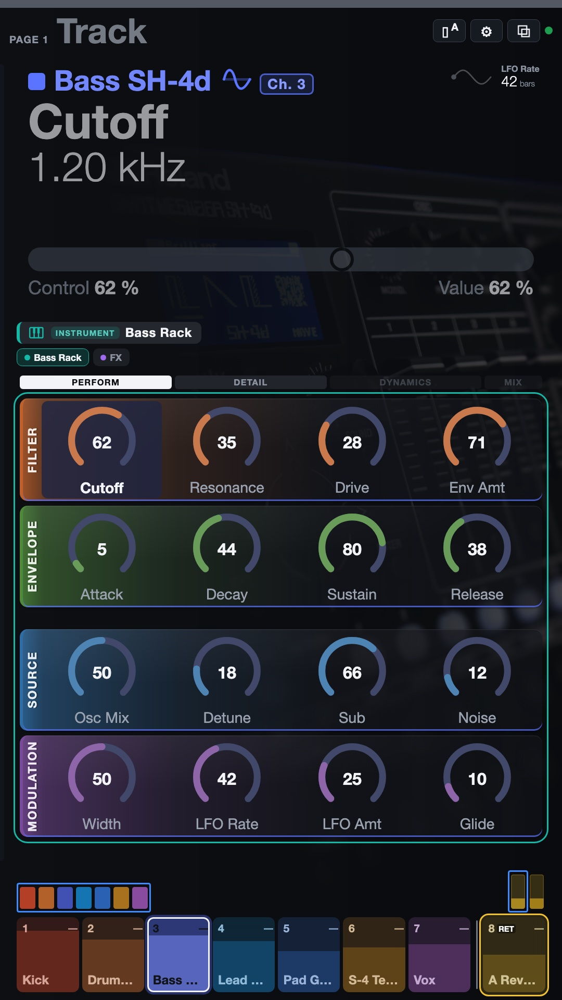
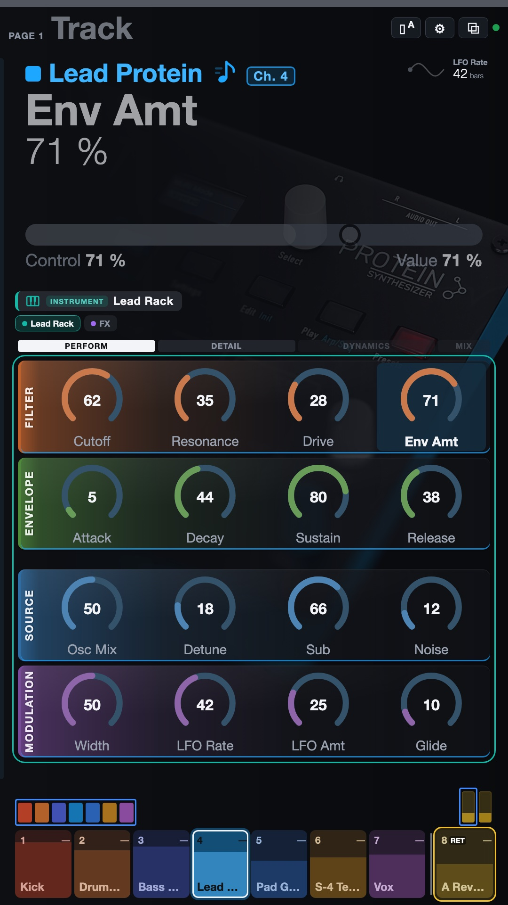
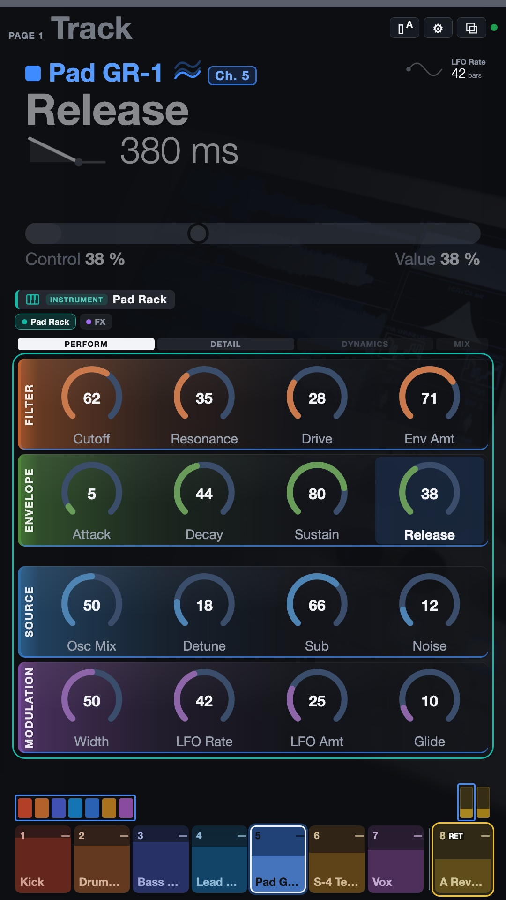

# Scribble Strip

A big-text window that shows what your controller is doing in Ableton Live: the track, the parameter and its value, the rack's macros, sends, meters and a picture of the synth. It listens to a Live remote script (today: [alias8-scribble](https://github.com/nygardsvulkanen/alias8-scribble), the Livid Alias 8) over UDP and runs in any browser.

  
  
  

*Portrait 1080×1920 at 150 % zoom, while a knob is turned. Demo data, not a real Live set.*

- Start: double-click **Start Scribble Strip.command** (or `python3 scribble_strip.py`), then open http://localhost:8643.
- Ports: UDP 9877 in (messages and state from the script), UDP 9878 out (commands to the script). They must match `STATUS_MIRROR_PORT` / `STATUS_CONTROL_PORT` in the script's settings.py.
- `synths/` holds the background pictures (1200×1920 jpg).

## Guide

Everything the script writes to Live's status bar is also sent to a small window in big text, so you can read it from a distance or on a second screen.

1. Double-click **Ableton/Scribble Strip/Start Scribble Strip.command** in the Livid Editor folder. A Terminal window opens (keep it open); it only starts the local server. Then open `http://localhost:8643` in your browser (bookmark it).
2. **Big text:** the track, then the parameter, then its value on its own line, while you turn a knob or move a fader. A yellow "↑ turn up to …" hint and the **pickup meter** show where your control is (dot) and where the value is (white line); "✓ caught" when they meet. Only knobs and faders change the big text: scrolling, arming, the send layer and selecting show for a moment in the top bar instead, and the last knob or fader stays on screen.
3. **Macros:** 16 knobs in the four groups of the rack layout, each group with its name on the left side and in its colour: Tone 1–4 (blue), Dynamics 5–8 (green), Character 9–12 (orange), Space 13–16 (purple). The arc and number show each value, the rack's own macro name is below; unmapped macros are empty. **The knob you're turning lights up**, and while it waits for pickup its arc shows the way to go: knob below the value = yellow from zero up to your knob, white from there to the value; knob above the value = white up to the value, yellow from there up to your knob. They show what the knobs reach on the current page: the selected track's rack, the selected return's rack on page 3, the Master rack on page 4.
4. **Sends:** shown in the return boxes at the bottom right (see below).
5. **At the bottom, like the buttons on the controller:**
   - a row of small boxes for **all tracks** (left) and **all returns** (right) in their true colours. A lighter grey behind the boxes marks what's on the controller's current page. Tracks inside a folded group (and `-` tracks) are thin slivers; a group track has a white line under it. The return boxes are larger: the bright bar in each is how much the selected track sends to that return.
   - the **8 buttons** of the current page in the tracks' true colours: dull, with the selected track bright and outlined. Each one shows the track's volume as a slightly brighter fill of the same tone rising from the bottom; the short line on the right is 0 dB. Big red dot = armed, M/S = muted/soloed (muted buttons are greyed), RET = a return, dashed yellow = the return whose send layer is on.
6. **Options in the top bar** (symbols; hover for their names): **Layout** ▭/▯ (key **L**, a small A = automatic): Auto (portrait when the window is taller than wide), Landscape or Portrait; portrait is made for a standing 16:9 screen like a 7" display at 600 × 1024, with the knobs in four rows. **Tint** (in ⚙ Settings, or key **B**): the whole background in a muted, dark version of the page colour. Double-click = full screen. The viewer is always dark. The viewer remembers your choices.
7. **Float**, the ⧉ button (Chrome and Edge): moves the viewer into a small window that stays on top of every app, Live in full screen too. Close it (or click "Bring it back here") to return. Keep the original browser tab open: closing it closes the floating window too.
8. **Level meters**: the thin strip on the right side of each button shows the track's output level (green, yellow near the top, red at the top; the short line is the recent peak). It moves about 10 times a second, fine for "is it playing, roughly how loud", use Live's meters for setting levels. Turn off with `STATUS_METERS = False` (section 12).
9. **⚙ Settings** (or key **,**), in four tabs: Knobs, Racks, Meters, Window (the last one used opens again): a small window with switches for the viewer: the number on the knobs (0–100 or the macro value as Live shows it), the order of the knob groups in portrait (1–4, 5–8, 9–12, 13–16 or 1–4, 9–12, 5–8, 13–16), knob highlight, pickup display, level meters and peak line, the track/return overview, the short top-bar messages, tint and layout. Saved in this browser.
10. **Time graphics**: when a knob shows a time, a small dot picture left of the value moves at that time: an LFO rate (low Hz or a synced rate, on a macro named Rate/LFO/Speed …; EQ, pass and cut macros never count) = a thin wave line with a bright stretch and a dot running along it once per cycle (fast rates: 2–4 cycles, swept faster); a delay time (Delay/Time/Echo) = a hit and three quieter echoes; Attack/Decay/Release (and Hold, Glide, Fade …) = a still envelope whose slope shows the time: nearly vertical = short, long and gentle = long (log scale, 0.5 ms – 10 s); attack rises, the others fall, and the slope swings smoothly to its new angle as you turn; any other time = a blinking dot. Synced values (1/16, 1/8D, 16th, 2 bars, and a bare number like 8, 1.5 or 1 on a macro with "Rate" in its name, read as bars) use Live's tempo; on the knobs such a number gets "bars" underneath. Switch off in Settings.
11. **Colour EQ curve**: turning a knob in the Colour group (a group named "Colour" / "Color", `COLOUR_EQ_WORDS` in settings.py section 13) shows one EQ curve, under the big text when there is room (portrait) or to its right, that all four Colour macros feed into. It only appears when the turned macro really moves an EQ device (EQ Eight, EQ Three or Channel EQ; the script checks which parameters changed, `SHOW_MACRO_TARGETS`), so a Colour macro that drives a Saturator shows no curve. Each macro is a band by its name: Low Cut / HP / Cleanup, High Cut / LP / Damp / Dark, Tilt / Tone, Air, High Mid, Presence / Bite, High / Bright, Low Mid / Mud, Mid, Sub, Warmth, Low / Bass / Body, Drive / Saturation / Tape … (a broad lift for the harmonics), Phaser / Flanger (notches); any other name is a soft bell by its place (150 Hz, 700 Hz, 2.5 kHz, 8 kHz). A value in dB is used as the gain and one in Hz as the frequency, otherwise the knob position. The knob being turned gets a white dot with its name and its own share as a dashed line; the curve eases to its new shape and goes away when another knob, a fader or the track changes. Name your own macros in `COLOUR_EQ` (e.g. `"Grit": "harmonics"`, `"Honk": "mid 800"`, `"off"`), range ± `COLOUR_EQ_RANGE` dB. Switch off in Settings → Knobs. **With an EQ Eight** in the track's racks the viewer draws that EQ's real curve instead (bands 1–8 with type, frequency, gain, Q and Scale, channel A, as numbered dots like in Live), and the bands the turned macro moves light up (e.g. Tilt = bands 5 + 6). Which EQ Eight: `COLOUR_EQ_DEVICE` by name, else one a Colour macro was seen moving, else one named Colour/Tone/Tilt, else the one with the most macro-controlled settings; `COLOUR_EQ_FROM_DEVICE = False` = always guess from the names. (Adaptive Q isn't modelled.)
12. **Fader legend**: the line right above the buttons always says what the faders do, split over the columns it applies to: VOLUME (grey), RETURN VOLUME (page colour), LEAD → SENDS on the Track page, !ECHO → OTHER RETURNS on the Returns page, SEND → !ECHO in the return's colour while a send layer is on (with LOCKED when locked). ▮ = volume, ◢ = send. During a send layer the bars in the buttons show the sends.
13. **Gain reduction** (needs the two Max for Live devices in `Ableton/Max for Live/`): put **A8 GR Pre** right before a compressor and **A8 GR Post** right after it, in the same chain (inside the rack, next to the Compressor). The Post device measures how much quieter the signal got and shows it in dB on itself and in the viewer: **A** a meter at the end of the Dynamics group (Glue on the Master page, Sidechain on the Returns page) for the track the knobs show, **C** an orange strip next to each button's level meter, **B** (off by default, Settings) a bar under the value while you turn a Dynamics knob. Make-up and output gain are found automatically: the largest after/before difference of the last 30 seconds counts as 0 dB, so give it a moment without compression (or it reads a little low). It sends to the viewer directly (OSC on port 9877) and needs no change in the script; restart the Scribble Strip once after updating. Cost: a few tenths of a percent CPU per pair. Save the pair into your rack presets to have it everywhere.
14. **Rates, always visible**: every macro with "Rate" in its name on the rack the knobs show (the selected track, return or Master) is shown at the top right with its LFO graphic and value, whatever knob you turn, and stays bright when the big text dims. Switch off in Settings.
15. **Changing track**: the big text shows the new track's last turned macro with its current value (remembered per track while the viewer is open); a track where no macro was turned yet shows just its name (the name is always there, also right after opening the viewer).
16. **Track colours on the name**: the track name above the big text gets a small square in the track's Live colour and is written in that colour (two names, each in its own colour, for a send: "Lead › Echo"). Two switches in Settings. Return names are shown without their ! or # mark (and the letter in front of it), here and on the buttons.
17. **Return columns, three states**: on the Perform and Track pages the fader legend ends with a small **RET** button that shows the state: **RET all** (the `!` and `#` returns), **RET !** (only the `!` returns) or **RET off** (no return columns: all 8 columns are tracks), on the Alias 8 too. Click it, or press **R**, for the next state (all → ! → off → all; a state that would look the same is skipped). Each page has its own. `RETURN_COLUMNS_START` (section 1) sets how each page starts (Perform `"!"`, Track `"all"`); a page in `HIDE_RETURN_COLUMNS` starts off. The viewer sends the command back to the script on port 9878 (`STATUS_CONTROL_PORT`, section 12); restart the Scribble Strip once after updating.
18. **Groups**: a group's button shows a soft, blobby blend of its own colour and the colours of the tracks inside it (each group keeps its own pattern; full strength up to the volume, paler above; on the channel strips the knobs and the name sit on a frosted panel) (the Alias 8 pulses through them instead, see Groups above). A focus group (name ending in `*`) has a **✱** tag; the one in focus has a solid outline and a **FOCUS** tag. The `*` isn't shown in names.
19. **Play / record**: at the top, left of the buttons: Live's transport. Triangle green = playing; circle filled red = arrangement recording, red ring = session recording only; grey = off.

20. **Synth pictures**: a picture of the synth the track plays fills the window's background, against the right edge and fading out to the left (in landscape it is enlarged to the window's full width). The knob groups get a dark faceplate: each keeps its own colour as a bar on the left that fades out to the right, with a line under it in the track's colour. The track name is never dimmed, even when the big value fades out. Right after it, a small icon for the track's role (synth-display style, in the track's colour): lead = musical note, arp = rising steps, pad = soft waves, bass = deep sine, texture = pixel grains, pluck = decay envelope, keys = keyboard, drums = 2 × 2 pads, kick = drum head, snare = drum with sticks, hihat (hats / tops / cymbals) = cymbals on a stand, percussion = triangle, noise = noise waveform. It fades over when you change track. Return tracks get their own picture (`RETURN_PICTURE`), and so do audio tracks (`AUDIO_PICTURE`, unless they're a bus), tracks with an External Instrument but no synth name found (`EXTERNAL_PICTURE`), tracks with one of Live's own instruments when no synth is found by name (`ABLETON_PICTURE`), and bus tracks: "bus" or "buss" in the track name or a rack name (`BUS_PICTURE`). After the track name, a small **Ch. 4** tag in the track colour shows the track's MIDI channel (the External Instrument's MIDI output if Live tells the script, else the track's MIDI To channel, else its MIDI From channel; `SHOW_MIDI_CHANNEL`, `MIDI_CHANNEL_FROM`). The synth is found by **name** (Live doesn't let a script read an External Instrument's "MIDI To"): the External Instrument's device name first (rename it "Protein", "SH-4d" …), then the track's routing, then the track name ("SH-4d Bass"). The role: a word in the track name, then in its racks' names (Bass, Lead, Pad …), then its devices' names. All in `settings.py` section 14 (`SYNTHS` with each synth's words, picture and fallback line colour; `ROLES` with each role's words; `RETURN_PICTURE`). Pictures are in `Scribble Strip/synths/` (jpg or png; replace them with your own photos under the same names). ⚙ Settings → Knobs → Synth: picture, faceplate, a track-coloured line along the left side of the window, role icon, MIDI channel; it also says what was found for the current track. The edge line under each knob group (track colour) is in ⚙ Settings → Racks, next to the kind-of-rack colour and the outline round the knobs.

How it works: the script sends each message as a small JSON packet over UDP (`{"type": "message", "text": "...", "page": 2, ...}`), and the controller state whenever it changes (`{"type": "state", "page": 1, "cols": [...], "macros": ..., "tracks": [...], "returns": [...]}`), to port 9877 on this computer; `scribble_strip.py` receives them and passes them to the browser page. Nothing is sent anywhere else. Settings: section 12 of `settings.py` (`STATUS_MIRROR`, `STATUS_MIRROR_HOST`, `STATUS_MIRROR_PORT`). To show it on another computer, set `STATUS_MIRROR_HOST` to that computer's IP address and `LISTEN_HOST = "0.0.0.0"` in `scribble_strip.py` there. If the viewer isn't running, the messages are simply dropped.

## License

MIT – see `LICENSE`. The pictures in `synths/` were made with Midjourney.
